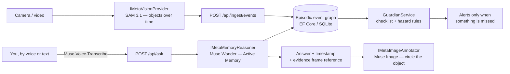

# EverRecall — Your Second Memory

**An AI home-memory assistant that answers "Where are my keys?" and "Did I take my pill?" from a timestamped episodic event graph — with evidence, not guesses.**

[](https://github.com/varunkonnojutech-lab/everrecall-ai/actions/workflows/ci.yml)
[](https://dotnet.microsoft.com/)
[](https://react.dev/)
[](https://www.typescriptlang.org/)
[](LICENSE)

> *"Where are my keys?"* — "Kitchen drawer, 9:41 AM." *(with the evidence frame)*
> *"Did I take my morning pill?"* — "Yes, 8:15 AM, blue bottle, kitchen counter."
> *"Did I lock the front door?"* — answered. *"Is the stove off?"* — answered.

EverRecall builds a **timestamped episodic event graph** from home video — who did what, to
which object, where, and when — and lets you query it like a person with perfect recall.
A **Checklist Guardian** watches the daily safety list (medication, stove, door, pet) and
alerts only when something is genuinely missed or a hazard persists.

Designed for Meta's model family (SAM 3.1, Muse Wonder, Muse Image, Muse Voice Transcribe
via the Meta Model API), and fully runnable **today, offline, with zero API keys** on
honestly-labelled simulated providers — add a real key and the production models plug
into the same interfaces. See [Honest scope](#honest-scope--what-is-simulated) below.

```bash
docker compose up --build
# Web app:  http://localhost:3000
# API:      http://localhost:8080   (Swagger: http://localhost:8080/swagger)
```

## What it does

On first run the API seeds one demo day:

| Time | Event |
|---|---|
| 8:15 AM | You **took** the **pill** — kitchen counter |
| 8:20 AM | You **turned on** the **stove** |
| 8:30 AM | You **fed** the **dog** |
| 8:47 AM | You **turned off** the **stove** |
| 9:02 AM | You **locked** the **front door** |
| 9:41 AM | You **placed** the **keys** — kitchen drawer |
| 9:55 AM | **Delivery driver delivered** a **package** — front door |
| 10:12 AM | You **placed** the **blue folder** — sofa |
| 10:20 AM | You **placed** the **wallet** — bedroom dresser |

Ask it (web UI, or `POST /api/ask`). Every answer below is real, captured from the running API:

| Question | Answer | Confidence |
|---|---|---|
| Where are my keys? | Your keys — last seen at **kitchen drawer** (Kitchen) at **9:41 AM** + evidence frame note | 0.98 |
| Did I take my morning pill? | **Yes — at 8:15 AM** you took the pill at kitchen counter + evidence | 0.97 |
| Where is my wallet? | Your wallet — last seen at **bedroom dresser** (Bedroom) at **10:20 AM** | 0.96 |
| Did I lock the front door? | **Yes — at 9:02 AM** you locked the front door | 0.96 |
| Did I turn off the stove? | Yes — off at 8:47 AM | — |
| Who came to the door? | **Delivery driver**, 9:55 AM | — |
| Did I water the plants? | **"I don't have a memory of that"** — EverRecall never invents | 0 (honest miss) |

### Checklist Guardian

`GuardianService` evaluates the stored day against four daily checks — **medication taken,
stove off, front door locked, pet fed** — as a pure function of (events, time):

- **Seeded day: ✅ ALL CLEAR** (medication ✓, stove off ✓, door locked ✓, pet fed ✓).
- **Hazard rule:** a stove ON for more than 30 minutes with no OFF event is a hazard.
  `POST /api/guardian/evaluate` with a stove turned on at 8:20 AM and no OFF event,
  evaluated at 9:30 AM, returns:
  `HAZARD: stove has been ON since 8:20 AM with no OFF event — over the 30-minute unattended limit.`

### Privacy — forgetting is a feature

`POST /api/memory/forget {"minutes": 60}` **physically deletes** every event in the window.
Try it: ask "Where are my keys?", forget the last hour, ask again — you get an honest
no-memory answer. The design stores the event graph (what happened, when), never raw video,
in a local SQLite file: no account, no cloud, no telemetry.

## Architecture



| Component | Where | Responsibility |
|---|---|---|
| Vision provider | `src/EverRecall.Api/Providers/` — `IMetaVisionProvider` | Frames/video → object/action detections → `MemoryEvent`s |
| Episodic event graph | `Data/EverRecallDbContext.cs` (EF Core + SQLite) | Durable store of actor / action / object / location / room / time / confidence / evidence |
| Recall engine | `Services/RecallEngine.cs` | Deterministic offline brain: object/action matching via an inspectable synonyms table |
| Memory reasoner | `IMetaMemoryReasoner` | Answers recall questions over the graph (simulated → delegates to `RecallEngine`; production → Muse Wonder) |
| Checklist Guardian | `Services/GuardianService.cs` | Medication / stove / door / pet checks + stove-on hazard rule |
| Image annotator | `IMetaImageAnnotator` | Annotates the evidence frame (Muse Image in production) |
| Transcriber | `IMetaTranscriber` | Voice questions → text (Muse Voice Transcribe in production) |
| Web UI | `web/` (React 18 + TypeScript + Vite) | Ask, day timeline, Guardian status, Forget — talks to the API via `/api` |

**Event graph first, model second.** Every answer is grounded in a stored `MemoryEvent`.
No event → no answer. That rule is what makes "I don't have a memory of that" possible —
and it is exactly the shape Muse Wonder replaces in production: same inputs
(question + event graph), same outputs (answer + confidence + matched event).

## Tech stack

| Layer | Technology |
|---|---|
| API | ASP.NET Core 8 minimal APIs, C# 12 |
| Data | Entity Framework Core 8 + SQLite |
| Web | React 18, TypeScript 5, Vite 5 |
| Tests | xUnit (13 tests) |
| Evaluation | Custom console runner — 30 staged scenarios |
| Containers | Docker + Docker Compose (API + nginx-served web) |
| CI | GitHub Actions — restore, build, test, evaluation, frontend build |
| Editor | VS Code F5 launch config + tasks; devcontainer included |

## Quickstart

### Option 1 — Docker Compose (recommended)

```bash
docker compose up --build
# Web: http://localhost:3000    API: http://localhost:8080    Swagger: http://localhost:8080/swagger
```

No keys needed — the simulated Meta providers are the default.

### Option 2 — Local development

```bash
dotnet run --project src/EverRecall.Api     # API on http://localhost:8080 (Swagger in Development)
cd web && npm install && npm run dev        # Web on http://localhost:5173 (Vite proxies /api to :8080)
```

**VS Code:** open this folder, press **F5** — the `EverRecall API (F5)` launch config builds
and starts the API and opens Swagger. The `run-web` task starts the frontend.

## Configuration

The API runs fully offline with **no configuration**. To activate the real Meta Model API
providers, supply a key — the DI container then swaps the simulated providers for the
HTTP implementations (same interfaces, no code changes):

| Setting (`MetaModelApi` section) | Default | Purpose |
|---|---|---|
| `ApiKey` | *(empty = simulated)* | Meta Model API key |
| `BaseUrl` | `https://api.meta.com/v1` *(placeholder host — confirm in the official docs)* | API base URL |
| `VisionModel` | `sam-3.1` | Vision / segmentation model |
| `MemoryModel` | `muse-wonder-1.0` | Memory reasoning model |
| `ImageModel` | `muse-image-1.0` | Evidence-frame annotation model |
| `VoiceModel` | `muse-voice-transcribe-1.0` | Speech-to-text model |

Every setting can also be supplied as an environment variable, e.g. `MetaModelApi__ApiKey`.
See `src/EverRecall.Api/appsettings.Example.json` for the full template and `.env.example`
for the Docker Compose variant. **Never commit a real key** — `.env` and real
`appsettings` overrides are gitignored.

## API reference

| Method | Endpoint | Purpose |
|---|---|---|
| GET | `/api/health` | Status + which provider mode is active (`simulated` / `meta-model-api`) |
| GET | `/api/events?room=&object=&from=&to=` | The day timeline, filterable |
| POST | `/api/events` | Add one event manually |
| POST | `/api/ingest/events` | SAM-style detection batch → memories (the real vision pipeline plugs in here) |
| POST | `/api/ask` | Ask a recall question |
| GET | `/api/guardian/status` | Checklist + alerts for the stored day |
| POST | `/api/guardian/evaluate` | Evaluate any supplied event set (hazard demo) without saving it |
| POST | `/api/memory/forget` | Privacy: delete everything from the last N minutes |
| POST | `/api/annotate` | Evidence-frame annotation for an event |

### Example — `POST /api/ask`

Request:

```json
{ "question": "Where are my keys?" }
```

Response (captured live from the seeded demo day):

```json
{
  "question": "Where are my keys?",
  "answer": "Your keys — last seen at kitchen drawer (Kitchen) at 9:41 AM. Evidence: Frame 09:41:12 — hand placing keys into the kitchen drawer.",
  "confidence": 0.98,
  "found": true,
  "matchedEvent": {
    "occurredAt": "…T09:41:00",
    "actor": "You",
    "action": "placed",
    "objectName": "keys",
    "location": "kitchen drawer",
    "room": "Kitchen",
    "confidence": 0.98,
    "source": "simulated-vision",
    "evidenceNote": "Frame 09:41:12 — hand placing keys into the kitchen drawer."
  },
  "relatedEvents": []
}
```

An unknown question returns `found: false`, `confidence: 0`, and an answer that says
plainly that EverRecall has no memory of it.

## Evaluation

```bash
dotnet run --project tools/EverRecall.Evaluation
```

30 staged scenarios against the seeded demo day (ground truth), scored on the actual
`RecallEngine`. Results from the current build:

```
object-recall accuracy: 15/15 = 100%
action-recall accuracy: 15/15 = 100%
Overall accuracy:      30/30 = 100%
Mean timestamp error:  0.0 seconds over 26 timed scenarios
```

Honest framing: the scenarios exercise the deterministic engine over the vocabulary it was
designed for (including synonyms: medication→pill, parcel→package, pet→dog, and honest
negatives: plants, glasses, garage, cat). They prove correctness and honesty on the demo
domain — not open-world performance. Widening vocabulary and free-form reasoning is
precisely Muse Wonder's job in the production path. CI runs the evaluation on every push.

## Tests

```bash
dotnet test
```

13 xUnit tests cover: object recall (location + exact time), action recall yes/no,
unknown → honest no-memory, who-came-to-the-door, Guardian all-clear on the seeded day,
Guardian HAZARD on a stove-on-unattended set, missing-medication alert, and the
forget-window rule.

## Honest scope — what is simulated

EverRecall's architecture is production-shaped, but be clear about what runs today:

- ✅ **Real and working:** the episodic event graph, recall Q&A with evidence and
  confidence, Checklist Guardian + hazard alerts, the forget/privacy rule, the web UI,
  Docker, CI, tests, and the evaluation runner.
- 🧪 **Simulated today:** all four Meta providers ship as offline `Simulated*`
  implementations behind their interfaces. The simulated vision provider converts SAM-style
  detection JSON posted to `/api/ingest/events` into events; the simulated reasoner
  delegates to the deterministic `RecallEngine`. Simulated outputs are labelled
  `SIMULATED` in their payloads — nothing is passed off as a real model response.
- 🔌 **Config-gated, not yet live:** the `Meta*` HTTP providers are registered only when
  `MetaModelApi:ApiKey` is set. Their request shapes are documented placeholders (endpoint
  paths and payload fields to confirm against the official Meta Model API documentation);
  they never fabricate a model response.

## Project structure

```
EverRecall.sln
src/EverRecall.Api/            ASP.NET Core 8 API (minimal APIs), EF Core + SQLite
  Program.cs                   Endpoints, DI, provider selection, first-run seed
  Models/                      MemoryEvent + request/response DTOs
  Data/                        DbContext + SeedData (the demo day)
  Services/                    RecallEngine (offline brain), GuardianService, Synonyms
  Providers/                   Meta provider interfaces + Simulated* + config-gated Meta* HTTP
tests/EverRecall.Tests/        xUnit — recall engine, guardian, forget rule
tools/EverRecall.Evaluation/   Console runner — 30 scenarios, metrics table
web/                           React 18 + TypeScript + Vite — Ask / Timeline / Guardian / Forget
.github/workflows/ci.yml       CI: backend build + test + evaluation, frontend build
.vscode/                       F5 launch config + build/test/web tasks
.devcontainer/                 One-click Codespaces / dev-container setup
docker-compose.yml             One-command run: API :8080 + web :3000
```

## Roadmap

- Plug in a real Meta Model API key: live SAM 3.1 video ingestion, Muse Wonder free-form
  reasoning over the graph, Muse Image evidence annotation, Muse Voice Transcribe input.
- Real camera ingest (RTSP / phone upload) feeding `/api/ingest/events`.
- Voice-first UI: ask by speaking, hear the answer.
- Medication schedules as data (per-person rules) instead of fixed Guardian rules.
- Multi-room cameras, family sharing with per-person consent, open-weights edge mode
  for fully local homes.

## Contributing

Contributions are welcome — see [CONTRIBUTING.md](CONTRIBUTING.md) for prerequisites,
build/test commands, and PR expectations. Security notes live in [SECURITY.md](SECURITY.md);
release history in [CHANGELOG.md](CHANGELOG.md).

## License

MIT — see [LICENSE](LICENSE).
